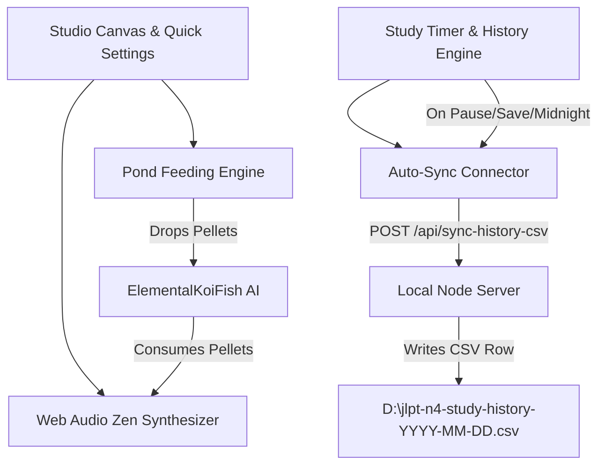

# Interactive Feeding, Zen Soundscape & Daily CSV Sync Design Document

**Date:** 2026-10-12  
**Status:** Approved by User  
**Author:** Antigravity  

---

## 1. Executive Summary

This design integrates three high-impact enhancements into the JLPT Study Studio:
1. **Interactive Pond Feeding & Nibbling Mechanics**: Clicking drops golden spirit pellets & floating lotus petals that both koi (`Tui` and `La`) detect, steer towards, and eagerly consume with celebratory ripples.
2. **Procedural Zen Web Audio Soundscape**: 100% lightweight procedural audio using the HTML5 Web Audio API (stream water pink-noise filters, periodic bamboo *shishi-odoshi* fountain clacks, meditation singing bowl chimes, and feeding droplet bloops) with a discrete master control in Quick Settings.
3. **Automated Daily D:\ CSV Sync**: Automatic background synchronization of today's study progress directly to `D:\jlpt-n4-study-history-YYYY-MM-DD.csv` whenever section timers pause, manual adjustments apply, or days roll over, with live visual sync indicator badges.

---

## 2. System Architecture

---

## 3. Detailed Component Designs

### A. Interactive Feeding & Nibbling (`elemental-koi-pond.js`)
- **Food Pellet Queue**: `this.foodPellets = []` (capped at max 5 items).
- **Properties**: `{ id, x, y, type: 'pellet'|'petal', age: 0, maxAge: 480, size: 5, ripplePhase: 0 }`.
- **Sensory & Hunting AI**:
  - In `update()`, if food exists, check distance to nearest pellet.
  - If `dist < 260px`, fish behavior transitions into `'seeking_food'`, smoothly adjusting `targetAngle = Math.atan2(pellet.y - this.y, pellet.x - this.x)` with energetic tail frequency.
  - On arrival (`dist < 15px`):
    - Pellet consumed, trigger micro ripple ring + 4-6 golden spore particles.
    - Sound effect triggered: `zenAudio.playBloop()`.
    - Fish switches to `'celebrating'` state (brief playful spin or accelerated forward burst).

### B. Procedural Zen Soundscape (`zen-audio.js`)
- **Audio Context**: `new (window.AudioContext || window.webkitAudioContext)()` initialized cleanly on first user interaction.
- **Synthesizers**:
  1. `streamNode`: Pink noise generator feeding a 2-pole Biquad bandpass filter ($650\text{Hz}$) with slow LFO gain ($0.12\text{Hz}$) for continuous babbling brook water.
  2. `playShishiOdoshi()`: Dual transient oscillators ($220\text{Hz}$ / $340\text{Hz}$) with short high-Q envelope simulating hollow bamboo strike.
  3. `playSingingBowl(freq = 432)`: Harmonically rich sine cluster with exponential 3.5s decay.
  4. `playBloop()`: Exponential upward frequency sweep ($600\text{Hz} \to 1200\text{Hz}$) over 90ms.
- **Controls**: Mute toggle button and master volume slider in `#quick-settings-popover`.

### C. Automatic D:\ CSV Sync (`server.js` & `app.js`)
- **API Endpoint**: `POST /api/sync-history-csv` in `server.js`:
  - Receives JSON payload of daily study stats.
  - Formats CSV row matching standard header.
  - Saves file to `D:\jlpt-n4-study-history-YYYY-MM-DD.csv` with UTF-8 encoding.
- **Frontend Trigger in `app.js`**:
  - Triggers debounced sync (3-second debounce) whenever `recordSessionInterval()`, `adjustSectionMinutes()`, or daily rollover occurs.
  - Header / Footer displays a sync badge (`☁️ Synced to D:\` or `⚠️ Local Only`).

---

## 4. Test Strategy & Acceptance Criteria
- Unit & integration tests in `test-zen-features.js`:
  - Pellet spawning, decay, and sensory detection logic.
  - Web Audio synthesis node initialization without browser crash.
  - CSV payload generation and endpoint response.
  - All existing 13 evolution tests and 12 studio acceptance tests remain 100% passing.
